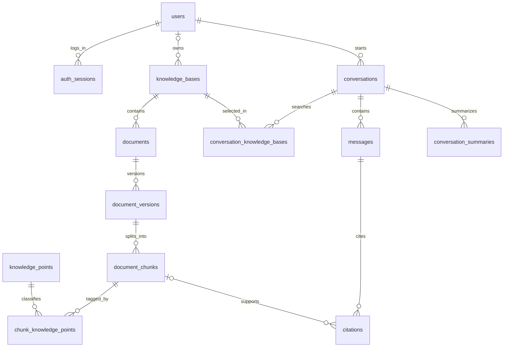
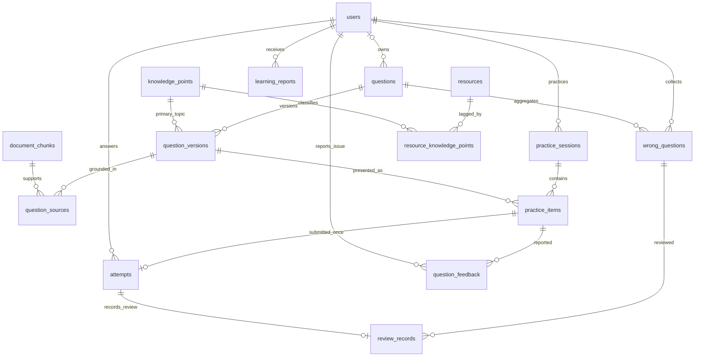

# 数据库设计 v0.1

创建：2026-10-09；更新：2026-10-10。用途：开发前的数据契约。业务存储采用 SQLite，文档向量采用 Qdrant 本地模式。

配套 [schema.sql](schema.sql) 可在空 SQLite 数据库执行；它是可验证的设计基线，实施时转换为 SQLAlchemy 模型和 Alembic 迁移。用户标识采用 UUID 字符串，时间保存为统一格式的 UTC ISO 8601，按用户时区显示。

## 1. 数据分工

| 存储 | 内容 | 作用 |
| --- | --- | --- |
| `data/app.db` | 账户、资料元数据、片段正文、聊天、引用、题目、作答、错题、报告、任务 | 业务事实和权限依据 |
| `data/vectors/` | 文档片段向量及检索过滤字段 | 可从文档及索引配置重建的检索存储 |
| `data/uploads/` | 原始 PDF、TXT、Markdown | 资料预览、重新处理和索引重建 |

数据库保存片段正文与来源；向量库保存向量及必要过滤字段，避免把对话、错题和报告同时放到两个数据库维护。

## 2. ER 图：知识库与学习对话



`course` 类型知识库为所有学生可读的预置课程资料，`owner_id` 为空；个人知识库为 `private`，必须有所有者。课程资料通过维护脚本管理，普通学生接口不能修改。

## 3. ER 图：练习、错题与报告



`jobs` 统一保存入库、清理、聊天、组题、总结和报告任务；`kind + target_id` 对应具体业务对象，由任务服务检查目标类型与权限。`learning_stats` 是查询视图，非独立可修改数据表。

## 4. 关键字段和约束

| 对象 | 关键字段 | 约束与规则 |
| --- | --- | --- |
| users / auth_sessions | 账户、密码摘要、时区；令牌摘要、到期时间 | 用户名忽略大小写唯一；数据库不保存登录令牌原文 |
| knowledge_points | code、parent_id、title | 编码稳定唯一；导入服务校验目录无环 |
| documents | kb_id、storage_key、content_sha256、deleted_at | 同一知识库未删除的相同内容唯一，跨知识库允许同一资料 |
| document_versions | version_no、status、is_active、模型及切分配置 | 同一文档最多一个活跃版本，活跃版本必须 ready |
| document_chunks | ordinal、location_json、vector_point_id | 同一版本片段序号唯一，向量标识稳定且全局唯一 |
| conversations / messages | 范围、教学模式；sequence_no、role、reply_to_message_id、status | 会话消息序号唯一，同会话最多一个正在生成的回答；回答明确关联同会话的用户问题 |
| citations | citation_no、chunk_id、标题与来源快照 | 同回答引用序号唯一，保留来源定位 |
| question_versions | 题干、选项、答案、解析、主知识点、核验状态 | verified 必须有人工或程序核验方式；题型和难度受约束 |
| practice_items | session_id、question_version_id、hint_used | 固定实际展示版本；提示使用由服务端记录 |
| attempts | answer_json、outcome、weight、is_first_attempt | 同练习条目只能提交一次；重复请求返回已有结果 |
| wrong_questions | user_id、question_id、错误次数、复习状态 | 同用户同根题目一个聚合条目 |
| review_records | wrong_question_id、attempt_id | 每次复习仍形成新的练习条目与作答，同作答最多一条复习记录 |
| learning_reports | 时间范围、数据截止时间、统计快照、版本 | 保存生成时的事实快照，不能静默改写历史报告 |
| jobs | 类型、目标、状态、进度、错误、请求摘要 | 同类型同目标最多一个 queued/running 任务 |

JSON 字段保存选项、配置、定位和快照；有关系约束的数据仍使用外键和关联表。SQLite 的表约束与外键能力依据官方文档；每次打开连接都必须启用外键。[表约束](https://www.sqlite.org/lang_createtable.html)、[外键说明](https://www.sqlite.org/foreignkeys.html)。

## 5. 资料版本与向量一致性

向量点示例：

```json
{
  "id": "<chunk_uuid>",
  "payload": {
    "owner_id": "<user_uuid_or_course>",
    "visibility": "private",
    "kb_id": "<kb_uuid>",
    "document_id": "<document_uuid>",
    "document_version_id": "<version_uuid>",
    "chunk_id": "<chunk_uuid>",
    "embedding_profile": "<profile_id>"
  }
}
```

向量点 ID 使用片段 UUID；`schema.sql` 中 `vector_point_id` 保存同一值。每个 Embedding 配置使用独立集合或明确兼容的索引版本。检索先从 SQLite 查出当前用户能访问且未删除、活跃 ready 的文档版本，再将其组成 Qdrant 过滤条件；命中片段回查权限和版本后才进入生成上下文。

新版本准备完成前旧版本继续可用；全部向量写入成功后，在一个短事务内取消旧活跃版本并激活新版本。版本切换后清理旧向量，失败清理可重试。查询在返回证据前重新校验有效版本，处理切换与删除竞争。

删除文档先设置 `deleted_at`，立即停止新检索与引用正文访问，再异步清理原始文件、片段正文和向量；SQLite 保留必要版本标识与历史来源状态。引用接口隐藏已删除资料的摘录。由该资料生成的个人题目标记撤销，相关作答和错题重算，避免继续披露资料内容。

## 6. 判题、幂等与学习统计

一次作答在同一短事务内完成：检查所属用户和条目 → 核验版本状态 → 记录作答 → 聚合错题及复习记录 → 更新用户 `learning_revision`。第一次作答判断按“用户 + 根题目”，而非页面刷新或题目版本判断。

权重由服务端计算：新题独立作答为 1；首次作答使用提示为 0.5；重复题为 0.25，同时使用提示时取较低权重。`is_first_attempt`、`weight`、判题结果均不能由客户端指定。

每次请求包含 `client_request_id`。相同键和相同请求摘要返回同一结果；相同键而请求内容不同返回冲突，不静默覆盖。条目已提交后，用另一个键再次提交也返回冲突；重做通过新练习条目完成。

统计时排除 `voided` 作答和 `revoked` 题目版本。时间范围和最近学习窗口由查询指定；`learning_stats` 视图作为全量事实基线，不直接代替按时间范围的计算。样本为零时表现值返回 null，不输出初始公式值。

知识点估计先只归属一个主要知识点；未来加入多知识点评分时需升级统计口径。首次作答正确率和复习正确率分别计算，避免重复背答案提高首次正确率。

撤销题目通过维护脚本完成：题目版本 revoked → 重算受影响用户错题 → 增加各用户 `learning_revision`。报告统计快照记录该修订号，读取时与当前修订号比较，提示旧报告数据已发生变化并提供重新生成入口。

## 7. 数据库与服务层各自负责什么

数据库负责主外键、唯一性、状态值和基础字段约束，并用复合外键保障练习条目、练习会话和作答用户一致，以及回答与原问题属于同一对话。

服务层负责当前用户权限、题目答案语义、课程资源只读、知识点无环、引用来源有效、复习用户及根题目匹配、任务目标类型匹配和合法状态转换。不能把“存在外键”当作已完成授权检查。

SQLite 写事务中不执行模型调用、文件解析和 Qdrant 操作。后台解析与生成在事务外进行，再用短事务保存状态和结果。单进程共用向量客户端，数据库锁等待与任务队列均有上限。

## 8. 设计验证

配套 `verify_design.py` 在内存数据库验证：建表与外键、活跃版本唯一性、未完成版本不能发布、跨用户作答拒绝、重复提交拒绝、同会话重复生成拒绝、撤销题目从统计排除。

这些验证只证明数据库设计可以执行及部分约束有效。模型回答质量、接口权限、后台重启恢复和真实 Qdrant 检索仍需在实现阶段验证。
