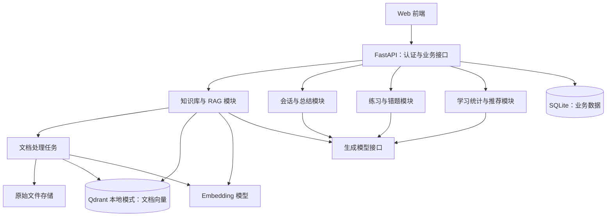

# 基于 RAG 的数据结构课程学习助手：项目规划

规划日期：2026-10-09；更新：2026-10-10。状态：已细化页面、数据模型和接口设计，尚未开始后端功能实现。

已确定：后端采用 Python / FastAPI，首版使用 SQLite + Qdrant 本地持久化模式。其余技术选型为建议，实施前结合开发环境、课程要求和模型接入条件确定。

2026-10-09 调整并经用户同意：首版存储改为 SQLite + Qdrant 本地持久化模式，面向单机、小规模课程资料和低写入并发；暂不需要单独部署数据库服务。

## 1. 项目目标与范围

系统面向学习数据结构课程的学生，将个人课程资料、自然语言答疑和练习记录连接起来，形成以下学习流程：

**上传资料 → 检索资料并答疑 → 针对薄弱知识点练习 → 错题复习 → 更新学习报告 → 推荐下一步学习资料。**

按一名开发者完成课程项目或毕业设计规划。首版包含用户提出的全部功能，但先限制题型、资料格式和推荐来源，以控制实现与验证工作量。

首版覆盖复杂度与递归、线性表、栈与队列、树、图、查找、排序、散列等课程主题。先以线性表、栈与队列、二叉树三个主题打通完整流程，再扩充课程内容。

首版支持学生账户和个人知识库，提供一套预置课程资料及经过核验的基础题库。预置内容由维护脚本管理；完整教师端、班级管理和考试管理放入扩展范围。

## 2. 功能划分

| 模块 | 首版交付内容 | 后续扩展 |
| --- | --- | --- |
| 账户与个人空间 | 注册、登录、个人资料、数据隔离 | 第三方登录、班级与教师角色 |
| 个人知识库 | 创建知识库，上传文本型 PDF、TXT、Markdown；查看处理状态，删除、重新处理资料 | DOCX、PPTX、扫描件 OCR、图表理解 |
| 自然语言学习 | 多轮答疑、概念讲解、算法步骤、复杂度分析、代码示例；回答展示资料引用 | 语音、算法动画、复杂图像题答疑 |
| 智能出题 | 按章节、知识点、难度和学习记录组题；生成并校验 AI 题目；首版单选与判断题 | 填空、简答、代码题与自动执行评测 |
| 错题库 | 已确认判错的题自动收录，保留作答与解析，按知识点筛选，重做及复习状态 | 间隔复习优化、变式题、错因聚类 |
| 对话总结 | 用户主动生成总结，整理知识点、疑问及后续行动；保存和导出 Markdown | 自动阶段总结、笔记编辑与关联 |
| 学习报告 | 按时间范围统计题量、正确率、薄弱知识点、复习情况，生成解释和学习建议 | PDF 导出、长期趋势、教师报告 |
| 资料推荐 | 推荐个人资料片段和预先录入的课程资源，说明对应知识点及推荐原因 | 联网检索、推荐反馈优化 |

学习报告和资料推荐属于首版完整交付；开发顺序放在练习记录形成之后。

## 3. 页面与使用流程

建议设置六个主要页面：

1. **学习首页**：近期学习记录、待复习错题、薄弱知识点、继续上次学习。
2. **我的知识库**：资料列表、章节标签、处理进度、失败原因、片段预览。
3. **学习对话**：会话列表、聊天区、引用资料侧栏；可从回答直接进入相关练习。
4. **练习中心**：指定章节或使用推荐练习；作答后显示结果、依据和解析。
5. **错题本**：错误记录、历史作答、复习入口、待复习与已巩固状态。
6. **学习报告**：时间范围、统计图表、知识点练习表现、学习建议与推荐资料。

对话提供“直接讲解”和“引导思考”两种模式。引导模式先提供提示、追问和小例子，学生需要时再展开完整答案。代码示例默认不执行。

典型流程：学生上传栈与队列讲义，询问循环队列的判满条件；助手引用讲义讲解并给出例子；学生完成相关练习；错题进入错题本；报告指出循环队列仍需巩固，并推荐讲义中对应章节。

## 4. 总体架构与技术选型

采用前后端分离、后端模块化单体架构。首版在一个后端工程中组织业务，使用单个后端进程；文档处理由该进程管理的后台任务执行，向量存储通过共享客户端统一访问。



| 层次 | 建议技术 | 用途与选择依据 |
| --- | --- | --- |
| 前端 | Vue 3 + TypeScript | 页面、聊天、练习和报告交互；前端选型仍可调整 |
| 后端 | Python + FastAPI | 已按用户偏好确定，集中实现业务与模型调用 |
| 关系数据库 | SQLite + SQLAlchemy，迁移使用 Alembic | 本地文件保存账户、文档元数据、对话、题目、作答、错题和报告，无需独立数据库服务 |
| 向量数据库 | Qdrant 本地持久化模式 | 使用 Python 客户端直接保存文档向量与检索元数据，无需启动 Qdrant 服务 |
| 文件存储 | 本地目录，数据库保存文件标识 | 适合首版部署；后续可替换对象存储 |
| 模型层 | 独立的生成模型、Embedding 接口 | 接入方式可配置；先以中文课程资料测试，再确定具体模型 |
| 后台处理 | 持久化任务记录 + 进程内后台执行器 | 文档解析、向量化、报告生成；记录状态并支持失败重试；统一协调向量读取和写入 |
| 部署 | 单进程 FastAPI + 前端，本地数据目录 | 首版无需 Docker 或独立数据库服务；提供开发启动、备份和演示部署说明 |

关系数据库保存业务事实，向量库负责语义检索。聊天历史、题目得分、错题状态等业务数据不能只放在向量库。

SQLite 是适合低写入并发、本地存储的嵌入式关系数据库，可满足首版账户、聊天、练习和报告的关系查询与事务需求。它允许多个读取者，但同一数据库同一时刻只有一个写入者；适合本项目的单机首版，后续大量并发写入时再评估服务型数据库。[官方适用场景](https://www.sqlite.org/whentouse.html)。

Qdrant Python 客户端提供本地模式，通过 `QdrantClient(path="data/vectors")` 持久化到磁盘，适合开发、原型和测试。首版使用持久化目录，不使用仅内存模式；保持检索模块接口独立，方便后续迁移。[官方客户端本地模式说明](https://github.com/qdrant/qdrant-client#local-mode)。

Qdrant 支持检索条件过滤，可用于按用户、知识库及文档版本限制检索范围；后续可评估混合检索。用户隔离仍须由后端认证和授权保证。本地模式不提供与服务模式相同的索引性能，不能用本地实验结果直接推断服务模式表现。[官方过滤说明](https://qdrant.tech/documentation/search/filtering/)、[官方混合检索说明](https://qdrant.tech/documentation/search/hybrid-queries/)、[本地模式实现](https://github.com/qdrant/qdrant-client/blob/master/qdrant_client/local/qdrant_local.py)。

首版先实现清晰的检索流程和模型接口，无需同时引入多个 RAG 编排框架。文档任务必须持久化，使用进程内后台执行并在重启时恢复或标记重试；CPU 密集解析放到受控线程或子进程，子进程不直接打开本地向量目录。若负载需要独立任务队列或多个后端进程，先迁移向量服务再调整执行架构。FastAPI 官方区分了轻量后台任务与适合使用独立任务工具的重计算任务。[官方后台任务说明](https://fastapi.tiangolo.com/tutorial/background-tasks/)。

### 4.1 本地存储与运行约束

建议数据目录：

```text
data/
├── app.db       # SQLite 业务数据库
├── vectors/     # Qdrant 本地向量存储
└── uploads/     # 用户上传的原始文件
```

- SQLite 启用外键约束，评估启用 WAL 并配置锁等待；保持写事务短小，不在事务内等待模型返回或完成文档向量化。WAL 改善读取与写入并行，但仍只有一个写入者。[官方 WAL 说明](https://www.sqlite.org/wal.html)。
- Qdrant 本地目录由一个后端进程内的共享客户端管理；首版运行一个 Uvicorn worker，统一协调客户端调用。同一目录不能由多个客户端实例同时打开，后续多进程访问应使用服务模式。[本地模式目录锁实现](https://github.com/qdrant/qdrant-client/blob/master/qdrant_client/local/qdrant_local.py)。
- 业务数据库与向量存储之间没有统一事务；以文档状态、稳定片段标识和幂等任务实现失败重试，只有向量写入完成的文档版本才发布。
- 数据放在本机磁盘，首版采用停机备份：停止后台任务并关闭数据库和向量客户端，再复制完整数据目录；不能在运行中只复制 `app.db` 就声称获得完整备份。
- 这里的轻量主要指部署与维护简单，实际内存和磁盘占用仍需按资料片段数、向量维度及模型部署方式测量。
- 如果出现持续写入排队，可迁移至 PostgreSQL；向量数量或检索延迟超出本地模式需求时，可迁移至 Qdrant 服务。保留 SQLAlchemy 数据访问层与检索接口有利于迁移，但仍需数据导入或向量重建及回归验证。

## 5. RAG 设计

### 5.1 文档入库

1. 校验文件类型和大小，保存原始文件与内容摘要，进行重复上传检测。
2. 创建文档版本与处理任务，显示 `queued → parsing → chunking → embedding → ready` 状态；失败时保存具体错误及重试入口。
3. 提取文本并保留章节结构。PDF 保存实际页码；TXT、Markdown 保存标题或行区间，不虚构页码。
4. 按标题、段落切分，尽量保持算法伪代码、公式、定义和例子完整。初始参数可设为约 500–800 个 token、重叠约 80–120 个 token，通过课程测试集调整。
5. 生成向量并写入 Qdrant；元数据至少包含用户、知识库、文档、版本、片段、章节和来源定位。
6. 全部片段可检索后发布该文档版本。重复任务使用稳定片段标识，防止重复向量。

文本型 PDF 解析失败或提取为空时明确提示。扫描件 OCR 属于扩展功能，不能显示为已成功入库。

更换 Embedding 模型时记录模型与维度，重建对应索引版本；不同模型的向量不能直接混用。文档删除后先禁止检索，再清理文件、片段和向量；失败清理任务可重试。

### 5.2 答疑流程

**学生问题 + 必要的会话上下文 → 确定检索范围 → 查询改写 → 向量检索 → 选择证据 → 生成答案 → 验证引用 → 保存回答。**

- 查询改写解决“它有什么区别”等多轮指代问题；保留原始问题用于追踪。
- 首阶段建立纯向量检索基线，检索候选数量和最终证据数量通过测试调整。
- 后续针对“入度”“出度”“O(log n)”等术语加入关键词或稀疏检索，再评估融合与重排序的收益。
- 所有检索调用从已认证用户和授权知识库生成过滤条件，不能信任前端传入的用户标识。
- 回答附真实的文档、页码或章节及片段引用；引用编号由后端给出，模型不能自行创建来源。
- 默认采用资料优先模式。证据不足时说明不足并引导补充资料；若提供一般知识补充，明确标记，不能伪装成来自知识库。
- 文档内容作为学习资料处理，不能覆盖系统指令或触发工具操作。
- 使用 SSE 展示回答生成过程；记录生成完成、失败及取消状态，失败片段不能当成完整答案保存。

引用记录保存文档版本与片段标识。资料删除后，历史引用提示“来源已删除”；账户数据清理时同步清理属于该账户的引用内容。

## 6. 学习情况与智能出题

### 6.1 建立知识点目录

知识点使用稳定编码和父子结构，例如：

```text
树
├── 二叉树性质
├── 前序 / 中序 / 后序遍历
├── 层序遍历
└── 二叉搜索树
```

题目、资料片段、作答记录和推荐资源关联同一知识点目录。文档自动标签允许修正；题目明确一个主要知识点，首版据此更新练习表现，避免一道错题直接拉低多个主题。

### 6.2 如何判断学习情况

以有效作答为主要证据，记录知识点、难度、是否正确、是否使用提示和是否重复作答。聊天提问可用于识别学习兴趣，不能仅凭提问次数判断掌握程度。

首版使用可解释的规则，展示“练习表现估计”与证据数量：

```text
知识点表现值 = (1 + Σ有效作答权重 × 是否正确) / (2 + Σ有效作答权重)
```

其中新题独立作答权重暂设为 1，使用提示暂设为 0.5，同一道题重复作答暂设为 0.25；采用最近一段时间的记录，参数实施时配置化。无记录时显示“未评估”，样本较少时显示“证据不足”，不能将初始值直接解释为实际掌握率。

低于 0.6 暂列为优先巩固，0.6–0.8 为继续练习，高于 0.8 为可尝试提高难度。这些是首版工程规则，需通过使用反馈调整，不代表经验证的教学测量模型。

题目撤销或判分修正后，能够依据有效作答记录重新计算统计。

### 6.3 出题与组题

1. 根据学生指定章节或薄弱知识点确定范围。
2. 检索资料中的定义、算法步骤和例子作为出题依据。
3. 从核验题库选题，或让模型按约定结构生成题干、选项、答案、解析、知识点、难度及来源。
4. 校验格式、选项唯一性、答案合法性、来源有效性及重复题。
5. 可计算的题目使用独立程序核验答案，例如栈操作结果、二叉树遍历、排序过程；概念题先人工抽查，必要时复核。
6. 校验失败时有限次数重试，仍失败则使用核验题库补足。未经核验的 AI 草稿不进入正式练习。
7. 服务端保存题目与答案；作答前的前端接口不返回答案或解析。

推荐练习初始配比可采用：60% 薄弱知识点、20% 错题相关新题、20% 当前章节拓展。学生可主动选择章节和难度，不被系统推荐限制。

AI 题目标明生成来源并提供“题目有问题”入口。确认有误后撤销相关判分及统计影响。第二次调用模型复核可以帮助筛查，不能代替独立答案验证。

### 6.4 判题边界

首版单选和判断题按核验后的标准答案确定结果，再生成解释。主观题作为后续功能，依据评分要点给出建议评分；不确定或存在争议时保持待复核，不自动计入掌握情况和错题库。

## 7. 错题、总结、报告与推荐

### 7.1 错题库

已确认判错的有效作答自动建立错题条目，保留原题版本、学生答案、正确答案、解析、知识点、错误次数与复习历史。同一用户同一题合并展示，但保留每次作答。

状态可设为“待复习 → 复习中 → 已巩固”。首版按固定间隔建议复习，连续两次正确且至少一次在不同日期完成后标记已巩固；该标记只是复习状态，知识点表现仍结合新题判断。

错题记录从提交接口幂等生成，重复提交不能重复计分或重复增加错误次数。

### 7.2 对话总结

总结基于实际会话，包含已讨论知识点、核心结论、学生仍不理解的问题以及后续建议。保留会话和消息范围，可跳回原始对话；失败回答不进入总结。

“讨论过某个知识点”与“已经掌握该知识点”分开表达。长期会话可采用阶段摘要加近期原始消息的方式控制上下文长度。

### 7.3 学习报告

后端先按用户和时间范围计算统计，再交由模型解释。首版包括：

- 已提交的有效题量、首次作答正确率、复习正确率与活跃日期。
- 各知识点的有效作答数、表现估计和证据数量。
- 待复习错题、重复错误及复习完成情况。
- 讨论过的学习主题、优先巩固项目和建议练习方向。

报告保存统计口径、时间范围、数据截止时间及生成版本。模型不能编造统计值；数据不足时生成起步建议，避免断言学习提升。没有可靠计时记录时不显示“学习时长”。

### 7.4 资料推荐

首版推荐池由个人知识库片段、预置课程资料和人工录入的外部资源组成。按知识点匹配、难度、薄弱程度和已读情况排序，显示推荐原因。

模型只负责解释已检索到的推荐候选；标题、链接和定位由数据库提供。外部资源导入时校验链接，推荐时处理失效状态，避免生成不存在的教材或网址。

## 8. 核心数据模型

| 数据实体 | 主要职责 |
| --- | --- |
| users | 账户、密码摘要、基础资料 |
| knowledge_bases | 知识库、所有者与可见范围 |
| documents / document_versions | 文件信息、版本、内容摘要、处理状态与索引配置 |
| document_chunks | 片段文本、来源定位、知识点关联与向量标识 |
| jobs | 后台任务类型、关联对象、状态、重试次数、进度与错误 |
| conversations / messages / citations | 会话、消息状态及实际来源引用 |
| knowledge_points | 课程知识点目录与父子关系 |
| questions / question_versions | 题干、题型、答案、解析、难度、来源与核验状态 |
| practice_sessions / practice_items | 一次练习与实际展示的题目版本 |
| attempts | 每次作答、使用提示、判题状态与有效性 |
| wrong_questions / review_records | 聚合错题、复习状态与每次复习记录 |
| learning_stats | 从有效记录计算的知识点统计视图；时间窗口由查询指定 |
| conversation_summaries / learning_reports | 总结、报告、统计快照及数据范围 |
| resources / resource_knowledge_points | 推荐资源、知识点、难度与链接状态 |

向量点保存 `owner_id、kb_id、document_id、document_version_id、chunk_id、embedding_version` 等过滤字段。业务关联表按实际需要增加，不将列表结构或所有学习记录塞进单一大字段。

模型相关记录保留模型标识、提示模板版本、检索参数、来源与调用状态，便于排查错误和复现实验。密钥由后端配置读取，不返回前端或写入仓库。

## 9. 接口与工程模块边界

主要接口按 `/auth`、`/knowledge-bases`、`/documents`、`/conversations`、`/practice-sessions`、`/attempts`、`/wrong-questions`、`/summaries`、`/reports`、`/recommendations` 划分。

后端划分认证、知识库、检索、模型适配、聊天、题目、练习、学习统计、报告推荐和后台任务模块。先完成模块之间的数据契约，再编写页面和接口细节。

文档上传返回文档和任务标识，前端查询状态；聊天接口流式返回回答与引用；作答接口负责判题及幂等记录；报告生成返回任务标识和统计范围。

需要从首版落实的运行要求：账户与文件授权校验、限制上传规模、模型超时与有限重试、错误状态可见、向量清理可重试、日志隐藏密钥、模型不可用时保留既有资料和练习功能。

## 10. 开发阶段与交付物

以下按单人开发估算，约 8 周，实际进度取决于已有基础、每周投入、资料质量和模型接入条件；此处不承诺完成日期。

| 阶段 | 建议时间 | 交付与验收 |
| --- | --- | --- |
| 需求与设计 | 第 1 周 | 确认资料格式、题型和页面；知识点目录、数据模型、接口契约；准备三个主题的样例资料和核验题 |
| 基础工程与入库 | 第 2 周 | 账户、SQLite 数据库迁移、文件管理、Qdrant 本地模式接入；上传资料后能查看状态并检索到片段 |
| RAG 学习对话 | 第 3 周 | 多轮对话、SSE、真实引用、证据不足处理；用固定课程问题验证回答 |
| 练习与错题 | 第 4–5 周 | 组题、AI 题目生成校验、判题、错题记录、复习；用真实作答跑通完整流程 |
| 学习分析与辅助功能 | 第 6 周 | 对话总结、报告、推荐；数字与原始记录一致，薄弱知识点能影响下一轮组题 |
| 内容扩充与质量评估 | 第 7 周 | 扩充课程主题；RAG 对比实验、生成题审查、权限和失败恢复验证 |
| 演示与交付 | 第 8 周 | 页面打磨、部署说明、测试报告、演示数据、论文或课程报告素材 |

最早可演示成果是“资料上传 → 带引用答疑”；完整成果必须覆盖“答疑 → 练习 → 错题 → 报告 → 推荐”的流程。

## 11. 验证与论文实验

### 11.1 功能验收

1. 用户 A 的资料、对话、错题和报告不能被用户 B 通过修改对象标识访问。
2. 同一资料重复上传和失败重试不能产生重复片段；重启后任务状态可解释并可恢复。
3. 文档删除后不能继续命中；历史引用正确提示来源状态。
4. 多轮追问可以保持上下文，回答引用定位正确；资料不足时不伪造来源。
5. 出题记录有知识点和可核验依据，答案在提交前不可见；生成校验失败时有可用题库回退。
6. 错误作答进入错题库，重复提交不重复计数，撤销有误题目后统计可重算。
7. 报告中的题量和正确率能够由记录复算；推荐来源存在且允许当前用户访问。
8. 无资料、无练习、模型超时、解析失败等状态在页面上有明确反馈。
9. 本地存储重启后数据仍存在；单进程下并发聊天、作答和文档入库能正确处理锁等待，停机备份可以恢复业务数据与向量。

### 11.2 RAG 效果实验

准备独立人工标注的课程问答集，初步规模可为 100 题，其中 40 题用于调参、60 题作为保留测试集；每题标注知识点、参考答案与支持片段，加入资料无法回答的题目。

使用同一生成模型与相近预算比较：

- 直接模型回答。
- 纯向量检索 RAG。
- 混合检索 RAG；若增加重排序，再单独评估其贡献。

检索评估支持片段 Recall@5 与排名；回答评估正确性、引用支持程度、证据不足处理；记录延迟与 token 使用。中文术语、代码、公式单独分组观察。生成答案由人工按预先确定的标准抽查或评分，模型评分只作辅助。

检索 Recall@5 可暂以 85% 作为开发目标，具体按标注口径和基线调整；这是目标值，尚无实测结果。性能指标应在实际硬件与模型确定后测量。

### 11.3 出题与个性化评估

人工抽查生成题的答案正确性、表述清晰度、选项歧义及课程相关性；记录校验通过率与回退率。根据同一学习记录比较随机组题与薄弱知识点组题，验证后者是否更多覆盖目标知识点并减少重复。

离线组题结果只能支持推荐策略有效执行；若要声称改善学习效果，需要前后测或对照学习实验，不能仅凭系统中的正确率变化下结论。

## 12. 展示重点与待确定事项

适合作为项目特点展示的内容：

- 保留章节、代码和公式的课程资料处理与真实引用答疑。
- 将知识点、有效作答、错题复习和个性化组题连接起来。
- 基于可复算统计生成报告，解释薄弱项并推荐已有资料。
- 用固定测试集展示 RAG 与普通模型回答、不同检索方法之间的差异。

后续实施前需要确定：前端是否采用 Vue、模型及 Embedding 的接入方式、课程资料来源、演示硬件、项目截止日期。当前方案默认文本课程资料、单选与判断题、SQLite + Qdrant 本地存储、单进程单机部署和可配置模型接口；这些假设均可调整。

详细设计见 [设计索引](design/README.md)，包含页面线框、数据库 ER 图、可执行 SQLite 建表文件和接口清单。下一阶段按“登录 → 资料入库 → 带引用答疑”的第一条流程开始实现。
