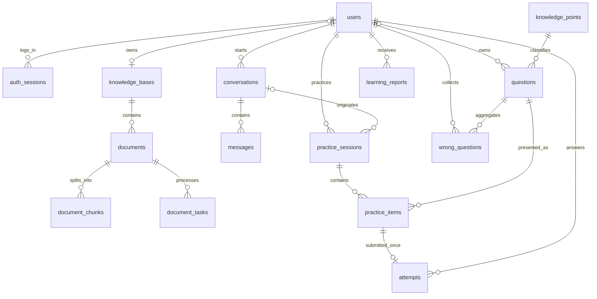

# 数据库设计 v0.3：首版精简模型

更新：2026-10-15。状态：首版整体建模方案；已实现十六个实体、0001–0007 迁移、文档、对话、练习、报告及维护资源。旧 schema.sql 为 v0.1 的 26 表草案，保留对照，不直接用作本版实施依据。

## 1. 简化原则

SQLite 继续保存业务事实，Qdrant 本地模式保存可重建的文档向量，本地目录保存原文件。数据库轻量并不意味着只能少建表；本次减少的是没有首版使用需求的历史版本、派生明细和小规模关联表。

首版一个默认个人知识库加一套只读课程资料。题目一旦分发内容不可变，后续修正生成新题，原题可停用。练习、作答和错题仍保持明确关系。

## 2. 建议的 16 个实体

批次 A 已落地 users、auth_sessions、knowledge_bases、knowledge_points 四张表，其余实体随功能加入。字段、默认库唯一性、会话与注册事务方案见 [下一阶段实施规划](../下一阶段实施规划.md)，不另设用户资料表。批次 B 已在注册接口实际使用用户、默认个人库与会话的完整事务，并通过接口失败回滚测试；文档批次通过 0002 加入 documents、document_chunks、document_tasks，0003 加入 conversations/messages，0004 加入 questions、practice_sessions、practice_items、attempts、wrong_questions，现已落地十四个实体。

| 实体 | 关键内容 |
| --- | --- |
| users | 账户、密码摘要、显示名称；首版统一 Asia/Shanghai，不增加时区设置页 |
| auth_sessions | 用户、会话令牌摘要、到期时间及 CSRF 所需信息 |
| knowledge_points | 固定课程知识点编码、标题和父级 |
| knowledge_bases | 课程库或个人库、所有者、名称；每用户一个个人库 |
| documents | 所属库、文件摘要、路径标识、状态、当前索引修订及配置、删除时间 |
| document_chunks | 文档与索引修订、片段正文、来源定位、向量标识、主要知识点可选 |
| document_tasks | 仅入库/清理任务的状态、错误、有限重试、关联文档 |
| conversations | 用户、标题、资料范围、最新总结与截止消息 |
| messages | 会话、顺序、角色、回复对象、正文、生成状态、结构化引用快照 |
| questions | 所有者或课程范围、主知识点、题干、答案、解析、资料来源快照、source_type（bank/ai）、可选校验方式、有效/停用状态 |
| practice_sessions | 用户、章节/推荐/复习模式、question_source（bank/ai）、知识点、题量、难度、可选 AI 出题要求、状态、来源会话可选 |
| practice_items | 所属练习、实际题目、顺序、提示使用；固定题目快照 |
| attempts | 用户、练习条目、提交答案、判题、首次/重复标记、有效性、提交时间 |
| wrong_questions | 用户、题目、复习状态、复习日期；历次结果从 attempts 查询 |
| learning_reports | 用户、日期范围、生成状态、统计快照、文字解释、生成时间 |
| resources | 维护的资源标题、实际地址、知识点标签列表、难度与可用状态 |

资料引用、来源快照、小规模资源标签使用经过验证的 JSON 字段。作答历史和练习条目不合并成大型 JSON，确保能查询、判分和复算。

出题方式复用现有实体，不新增题库与 AI 各自的练习表。questions.source_type 表示题库或 AI 来源，资料引用另存在来源快照中；答案保存于题目及分发快照。bank 题入库前完成核验；ai 题在结构校验后可直接参与练习，不要求人工或程序校验才能设为有效。可选 validation_method 仅记录实际进行的人工或程序检查，未执行时为空，不因完成格式校验而标记为答案已核验。

普通新练习的 question_source 固定为 bank 或 ai，与章节/推荐模式独立；generation_requirements 仅在 ai 模式保存。复习会话 question_source 为空，按所选原题组成练习，每个条目保留原题来源，可同时包含题库题和 AI 题。已开始练习不修改出题方式，切换后创建新练习，不改写旧题或旧答案。

## 3. ER 图

课程库和课程题没有个人所有者；访问权限由课程范围及用户检查确定。resources 的小规模标签可查询或在服务层匹配，无需首版单独关联表。

## 4. 从原始设计如何收敛

| 原设计 | 本版处理 |
| --- | --- |
| document_versions | 合入 documents 的当前索引修订与处理状态；不保留多个可切换历史版本 |
| chunk_knowledge_points | 首版每片段一个主要知识点或未标注；查询也可直接按文档范围 |
| conversation_knowledge_bases | 范围在 conversations 中保存，服务层每次核验可访问文档 |
| citations | 结构化引用列表保存于 messages，含来源标识、定位和引用快照 |
| question_versions / question_sources | questions 保存不可变内容及来源，修改创建新题，练习条目保留快照 |
| review_records | 从复习会话中的 attempts 查询，不重复写一套结果 |
| question_feedback | 首版将反馈理由和时间保存于已作答条目，维护脚本读取；不建设反馈管理后台 |
| conversation_summaries | conversations 保存最新总结、状态和截止消息 |
| resource_knowledge_points | 合入 resources 的少量标签 |
| jobs | 缩减为 document_tasks，其余生成状态在消息、练习、会话和报告自身记录 |
| learning_stats / learning_revision | 普通知识点统计查询，暂不建立全局加权视图与报告失效修订机制 |

首版结构是实现建议，具体字段长度、索引和迁移在编码前确定；不声称本版 16 表已通过原 26 表的约束检查。

## 5. 必须保留的约束

- 用户账户和个人数据访问隔离；课程内容只能由维护者写入。
- 每用户最多一个默认个人库；同库重复文件能检测。
- 未删除且 ready 的文档与当前修订才可检索；匹配向量后复查来源权限。
- 回答关联同会话的用户问题；失败、取消和完成区分。
- 练习条目与会话属于同一用户，作答只能关联本人的条目。
- 每条练习条目最多一次提交；重复请求返回已保存结果或明确冲突。
- 题干和答案在分发后不可静默修改，原记录保持原题快照。
- 普通练习的出题方式与条目的题目来源一致；复习按原题来源和快照，不重新生成。
- 同用户同题目一个错题聚合条目；多次复习仍有多条 attempts。
- 无效题或作答从当前统计排除；报告保留生成时快照和口径。
- 资料删除停止未来检索，历史本人学习记录不级联删除。

这些关系与约束优先于减少表数。若后续出现可靠的多对多查询或版本审计需求，可以增加对应表。

## 6. 索引与任务一致性

向量点保存 kb_id、document_id、index_revision、chunk_id、owner/scope 和 Embedding 配置标识。检索先由 SQLite 生成当前用户的有效文档与修订范围，再执行向量过滤并回查权限。

重新处理时将文档设为处理中，当前文档暂退出检索；新片段和向量全部完成后设为 ready。失败保留原文件，允许有限重试；使用稳定修订与片段标识避免重复。首版不实现无停顿版本切换。

document_tasks 只负责解析、索引和清理。不在 SQLite 写事务内调用模型、向量库或文件解析。消息、报告等生成在自己的对象保存状态，不把它们全部包装成多态通用任务。

资料删除的历史快照仍属于同一个用户；引用提示来源已删除，不继续返回原文件。清空学习历史如果后来加入，是单独明确操作，而非普通资料删除副作用。

### 已落地的文档约束

同库未删除文件按摘要唯一，删除后释放去重键，原 hash 保留；ready 必须具有有效配置标识和正向量维度。当前修订与片段位置组成唯一键，任务请求标识在同文档内唯一；页码、行号、修订、次数与大小均有检查约束。所有外键开启，删除仅标记文档并清理文件/向量，片段不级联销毁。

SQLite 并发更新在短 BEGIN IMMEDIATE 事务内取得写锁后读取可变状态；不在事务内等待外部模型。文档处理最多 2000 片段，Embedding 批量 16 个；清理失败最多自动尝试三次。具体模型调用尚未接通，测试替身只验证管线和状态约束。

### 已落地的会话约束

用户与会话外键、消息回复对象外键、会话内顺序唯一、请求标识唯一、角色/状态/意图检查约束已落地。生成中的 assistant 消息通过部分唯一索引按会话唯一；序号和幂等在短写事务分配。资料范围保存于会话，新回答另存范围快照；重试不修改原回答。引用存于消息，资料删除后保留历史。

0003 回滚在删除消息表前解除该表内部回复关系，避免 SQLite 的隐式 DELETE 被自引用 RESTRICT 阻止；始终保留外部外键校验。回滚测试使用独立临时库，不回滚真实运行库。

### 已落地的练习与错题约束

练习请求按用户和请求标识唯一，同一条目仅一条 attempt；同用户同题只保留一个错题聚合。题目来源与所有者、练习模式与出题方式、状态、题序与复习天数有数据库检查约束。SQLite 触发器禁止已分发题目的正文/答案/来源变更，以及条目快照和顺序变更；提示与反馈可单独写入。修改题库包创建新题，不覆盖历史。

题库按固定摘要重复导入跳过；AI 题以同用户、知识点、难度、题干和选项内容指纹去重，完全相同的题沿用原题及参考答案，重复作答不算新题。不做语义去重或额外答案核验平台。首次独立、首次提示、重复和复习分类在 BEGIN IMMEDIATE 写事务内判定，防止并发重复计数。

错题正确日期使用 Asia/Shanghai，tzdata 补齐 Windows 的时区数据。相同日期多次答对只计一次连续正确日期，跨日期两次答对标记该题已巩固，任何再次答错重置。原始 attempts 不被覆盖。维护者停用题目只修改有效性；当前统计和候选排除，历史快照保留。

## 7. 学习统计与历史记录

最近 30 天知识点表现采用不同新题的首次独立作答。提示作答和复习次数分开展示。少于 5 道独立新题时返回证据不足，正确率没有分母时返回 null。当前表现来自有效题与有效作答，不建立加权掌握分。

题库题和 AI 题都参与练习反馈、错题与统计：题库使用核验答案，AI 使用分发时保存的参考答案。题目来源随作答关系保留，统计与报告标明包含两种来源，AI 题不会仅因未做程序验算而排除。经确认有误后统一停用并排除当前统计。

当前报告页数据实时查询；保存的报告固定生成时快照、日期范围和数据截止时间。停用有误题目后当前统计重算，历史报告不静默改写；说明其采用生成时口径，用户可重新生成。

报告不存重复可编辑事实表，复习记录不复制 attempts。必要的错误次数可查询得出；仅用户复习状态需要保存。

## 8. 验证状态

原 verify_design.py、schema.sql 与 qa/schema-checks.json 属于 v0.1，证明原设计部分约束可执行，不证明本版精简模型已实现或验证。

规划自检时未执行本版业务表的 SQL 检查或浏览器检查。工程初始化验证了 SQLite 连接配置、Qdrant 持久化及迁移框架；这些检查不代表 16 个业务实体已实现。后续将其余实体转换为 SQLAlchemy 模型和迁移，再验证唯一提交、无效题排除、资料状态和统计复算。

批次 A 已对实际四表迁移验证了唯一约束、非法库类型与所有者、外键、事务回滚、UTC 时间读取、课程初始化幂等与已有数据保留；迁移降级只在测试临时库执行。课程固定目录已写入本地数据库；0002 后课程导入登记三个文档与任务，不将未向量化文件标 ready，未添加学习记录。

0005 在 conversations 内保存最新总结的状态、内容、消息截止范围、生成时间与请求确认标识。输入快照仅在生成中保存，终态移除；生成失败保留上一次成功内容与其原范围。没有新增历史摘要表或通用生成任务表。

0006 加入 learning_reports：用户、日期范围、截止时间、不可变统计 JSON、生成状态、文字、请求标识和生成时间。SQLite 触发器禁止改写事实快照与已完成报告；生成中的报告只更新文字与状态。请求标识按用户唯一，默认日期重试仍复用原快照。降级只删除新增报告表，在有账户及练习记录的临时库验证，真实库只做备份升级。

0007 加入 resources（第十六个实体）：稳定 code、知识点、标题简介、真实 URL、阅读难度、语言、作者许可与核对日期 JSON、启用状态。维护者 CLI 校验完整数据包后按 code 新增或更新；无用户反馈画像表、推荐日志表或模型版本平台。推荐只查询有效错题与可读文档当前片段，不新增向量副本。
