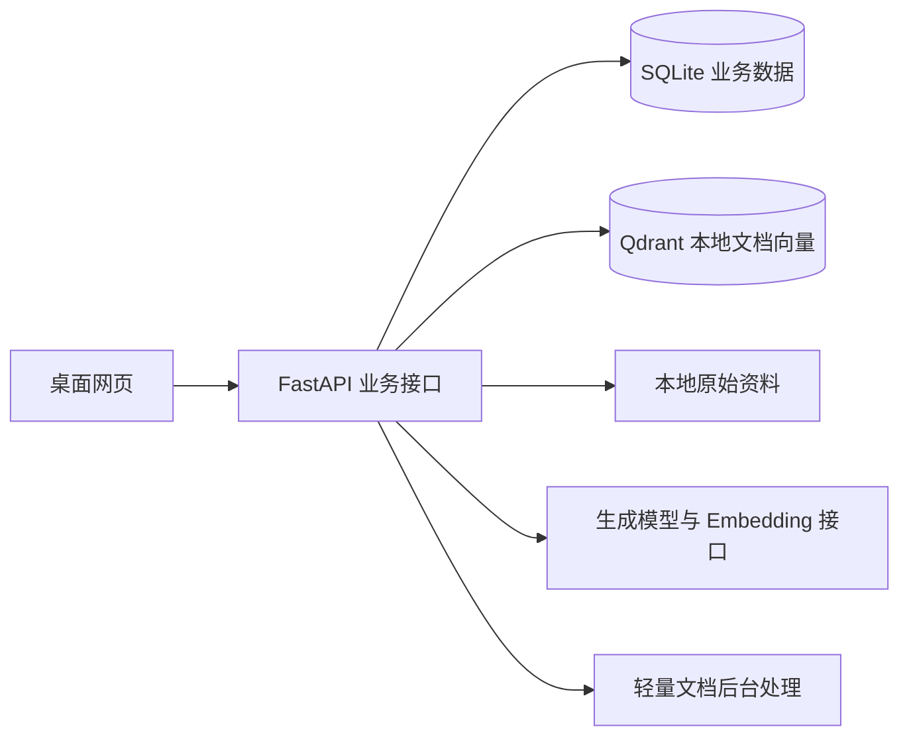

# 基于 RAG 的数据结构课程学习助手：项目规划 v0.3

规划日期：2026-10-09；自检与出题方式修订：2026-10-10；实施顺序细化：2026-10-11；实施更新：2026-10-16。状态：基础工程、七批迁移、课程初始化、简单账户及知识库与课程目录接口和页面已完成；资料管理与处理管线已完成，会话与检索管线已实现，练习与错题已接入，会话总结、报告统计与快照导出已接入，资料推荐已接入，DeepSeek 生成与千问 Embedding 的 HTTP 适配已实现；真实模型调用、隔离学习闭环、30题对照与针对性内容回归已完成；详见 [验收记录](真实模型闭环验收记录.md)。当前工程入口见 [仓库说明](../README.md)。

本版按用户要求定位为桌面网页：不开发手机端适配，不建设浏览器自动检查平台；2026-10-16 用户已授权本次真实可见浏览器验收。后端确定为 Python / FastAPI，存储确定为 SQLite + Qdrant 本地持久化模式。

输入确认：先整理公开、可合法使用的课程资料和小型核验题库，记录来源及许可说明。2026-10-16 已确定生成模型使用 DeepSeek、Embedding 使用千问；接口和非敏感默认配置已准备，密钥已由用户在本地手动填写并完成真实联调。未配置模型时基础功能仍可用，真实向量入库、答疑和 AI 生成需填写密钥后验收。完整开发目标见 [初版目标提示词](初版目标提示词.md)。

实施记录：首批 3 份中文笔记、15 道固定题和 30 个 RAG 评估问题已完成内容准备及来源、结构、计算检查，笔记已有维护者导入命令；本地登记三份待处理文档，尚未向量就绪，15 道核验题已导入，可用于题库练习。来源与许可见 [内容说明](../content/README.md)，完整功能进度和待完成项见 [初版实施进度](初版实施进度.md)。

## 1. 目标与学习流程

面向学习数据结构课程的学生，支持个人课程资料、自然语言答疑、针对性练习、错题复习、对话总结、学习报告和资料推荐。

**使用课程资料或上传个人资料 → 对话理解知识点 → 针对性练习 → 错题复习 → 查看统计和报告 → 阅读推荐资料。**

上传个人资料是可选入口。注册后自动登录并创建一个个人知识库；课程资料完成入库后，学生可直接使用预置资料开始学习。首版先以线性表、栈与队列、二叉树跑通流程，再扩展图、查找、排序、散列和复杂度等课程内容。

## 2. 首版功能边界

| 模块 | 首版 | 延期 |
| --- | --- | --- |
| 账户 | 注册自动登录、登录状态恢复、退出、修改显示名称、个人数据隔离 | 教师端、班级、第三方登录 |
| 知识库 | 一个默认个人库 + 只读课程库；文本型 PDF、TXT、MD 上传、预览、删除、失败重试 | 多个人库、扫描件 OCR、DOCX/PPTX、历史版本发布 |
| 学习对话 | 多轮答疑、真实引用、例子与代码说明；默认直接讲解，可请求提示 | 语音、算法动画、代码执行 |
| 智能练习 | 单选与判断题；题库出题 / 实时 AI 出题切换；AI 可生成所有课程知识点的概念、算法及综合题；按知识点组题 | 主观题评分、代码评测 |
| 错题 | 自动收录、历次作答、按知识点筛选、复习状态 | 自适应间隔算法、复杂错因聚类 |
| 对话总结 | 同会话保留最新总结和截止消息，导出 Markdown | 总结历史版本、编辑笔记系统 |
| 报告 | 实时统计；按需生成解释；历史报告快照和 Markdown 导出 | 全局学习修订机制、PDF 报表平台 |
| 推荐 | 个人资料片段、预置资料、维护的实际外部资源 | 联网检索、协同过滤、推荐训练平台 |

全部原始核心功能仍在首版范围内，延期项用于控制实现难度。

## 3. 桌面页面和默认操作

保留六个主页面：学习首页、我的知识库、学习对话、练习中心、错题本、学习报告。桌面布局使用左侧导航、主要内容区和可展开引用侧栏。

首页突出“开始学习”，同时提供上传和基础练习入口。对话中的“练习这个知识点”自动携带知识点，默认 5 题、基础难度；高级设置可展开调整。练习配置区直接提供“题库出题 / 实时 AI 出题”切换，记住当前用户上次选择。提交题目在本页显示解析并自动收录错题，不强制跳页。练习结束后可返回原会话。

刷新恢复会话、已提交题目及当前练习位置。未提交选择可作为按用户隔离的页面草稿保存，但统计只采用服务端提交记录。

用户只看到有意义的状态，如“资料处理中”“可用于学习”“失败可重试”。向量参数、任务编号、内部阶段和索引配置不进入日常学习操作。

## 4. 简化架构

采用前后端分离、模块化单体、单机单进程部署。

| 层次 | 方案 |
| --- | --- |
| 前端 | Vue 3 + TypeScript + Vite，桌面页面优先；基础工程已采用此选型 |
| 后端 | FastAPI，各模块在同一工程内 |
| 关系存储 | SQLite + SQLAlchemy；基本迁移和必要约束 |
| 向量存储 | Qdrant 本地模式，共享一个客户端 |
| 文件 | data/uploads，本地管理 |
| 模型 | 一个生成配置、一个 Embedding 配置，通过适配接口调用 |
| 文档任务 | 记录状态、有限重试、启动时识别中断；不建设通用任务平台 |
| 部署 | 后端一个 worker；首版不依赖 Docker、Redis、Celery或微服务 |

业务表保存事实，向量库用于可重建检索。保持 SQLite 写事务短小，模型、文件和向量操作在事务外执行。Qdrant 本地目录由单个后端共享客户端访问。相关运行边界沿用已核对的 [SQLite 适用场景](https://www.sqlite.org/whentouse.html) 和 [Qdrant 本地模式](https://github.com/qdrant/qdrant-client#local-mode)。

## 5. RAG 实现逻辑

上传后校验文件 → 保存原文件 → 提取文本 → 按章节和段落切分 → Embedding → 写入向量 → 文档标记就绪。

片段保留实际页码、标题或行区间，尽量不拆散代码、公式、定义与例子。首版选择一种切分方案和纯向量检索，按课程问题调整片段大小与检索数量；混合检索和重排序仅在证据显示有必要时再加入。

检索先检查当前用户与资料范围，只访问未删除且就绪的文档。回答依据真实命中片段生成，引用编号由后端提供；资料不足时明确说明。文档内容不能覆盖系统指令。

文档重新处理时暂时退出检索，完成后发布当前索引；其他资料可用。保存轻量索引修订标识和配置用于排错，不实现多历史版本并行发布。更换 Embedding 配置时停机重建，首版不提供动态多模型索引切换页面。

资料删除后停止未来检索并清理原文件及当前向量，历史同用户回答、题目快照和作答仍保留，引用标记来源已删除。删除前说明这一行为；清空历史学习数据是另一项操作，不能由普通文档删除隐式触发。

聊天保留生成、完成、失败和取消状态；使用 SSE，断线后读取消息快照恢复，不建设逐事件重放系统。服务重启中断的回答标记失败，允许用户主动重试。

## 6. 智能出题与判题

知识点使用固定课程目录，题目关联一个主要知识点。初次用户从所选章节获得基础练习，有足够有效记录后优先练习较弱项。

练习中心提供两种可切换的出题方式，两者共用知识点、题量、难度和答题流程：

| 出题方式 | 内容与生成逻辑 |
| --- | --- |
| 题库出题 | 从预先核验的题库选题，概念题是题库的主要内容；按知识点、难度和近期作答筛选 |
| 实时 AI 出题 | 根据课程知识点、可用资料、学习情况及可选的自然语言要求生成新题；覆盖概念理解、算法过程、复杂度分析与综合应用等内容 |

实时 AI 出题不限定为栈操作、遍历、排序，也不限定算法模板；题目无需通过独立程序验算或逐题人工审批才能用于练习。只要求题干、选项、参考答案、解析等结构完整且格式合法。能够程序验算的题可按需辅助校验，这不构成出题范围的门槛，也不要求建设模板或复核平台。

首次使用默认题库出题，之后记住上次选择。切换保留知识点、难度和题量，作用于下一组新练习，不改变已开始练习的题目和记录。实时 AI 模式可填写“重点考复杂度”“结合链表例子”等出题要求，也可直接开始。题库不足时展示实际题量；AI 生成失败保留设置并提供“重试 / 切换题库”，不会自动改变用户选择的出题方式。

题库按核验答案判题；AI 题按生成时保存的参考答案提供练习判分和反馈。页面标注“题库题 / AI 生成”，AI 解析中的答案标为参考答案，不将其标为人工核验。两种方式都接入错题、复习和学习统计；经确认有误的题目停用并排除当前统计。题目来源随记录保留，便于解释结果与反馈修正。

题干、答案、解析和来源在分发时形成不可变题目快照。作答前不向前端返回答案；提交一次只计分一次，重做生成新的练习条目，历史作答不覆盖。修正题目生成新题，不静默改写已作答的内容。

## 7. 学习情况、错题和推荐规则

首版显示事实与证据，暂不采用加权掌握公式或固定 60/20/20 组题比例。

- 展示知识点最近 30 天首次独立作答的题量和正确率。
- 使用提示的首次作答单独标识；复习与重复题另行统计。
- 少于 5 道不同新题的首次独立作答显示“证据不足”，不宣布知识点薄弱。
- 样本足够后，正确率低于 60% 暂列优先巩固；其他知识点继续练习，增加难度由学生选择或建议提示。
- 此规则用于首版排序，不代表经验证的学习能力测量。

错题自动收录，保留错误与复习记录。不同日期连续两次答对可标记该题已巩固，再次答错重新待复习。题目状态不能直接代替知识点掌握。

推荐按知识点匹配、适当难度和有效错误记录排序，来源只来自有权限的资料或维护的真实链接。先以规则给出可解释原因，模型解释为可选功能。

## 8. 总结与报告

会话中按需总结已完成消息，保存最新总结及消息截止位置。不要把“讨论过”写成“已掌握”。

报告页默认展示最近 7 天实时统计，无需模型即可查看。生成文字报告时固定时间范围、数据截止时间和统计快照，再由模型解释，不编造数字。历史报告保持生成时事实，重新生成产生新报告，不引入全局报告自动失效与同步机制。

统计排除已确认无效题和作答。历史报告始终标明生成时间、统计范围和是否为最新生成版本；题目后来被停用时保留当时统计口径并提供说明，当前统计使用有效记录。没有可靠计时数据时不显示学习时长。

## 9. 数据与接口边界

首版建议 16 个实体：users、auth_sessions、knowledge_points、knowledge_bases、documents、document_chunks、document_tasks、conversations、messages、questions、practice_sessions、practice_items、attempts、wrong_questions、learning_reports、resources。

结构化引用、小规模资源标签、会话资料范围和最新总结可放在对应对象的字段中。练习条目、作答和错题保留明确关系，不为了压缩表数而牺牲历史记录与数据隔离。

接口按账户、知识库、资料、对话、练习、错题和报告组织。只有需要防重复的生成与提交动作采用请求标识，读请求不承担业务修改。所有对象访问需要检查当前用户权限。

详细说明见 [页面设计](design/页面设计.md)、[数据库设计](design/数据库设计.md)、[接口设计](design/接口设计.md)。原 26 表 schema.sql 是 v0.1 对照草案，不是本版直接实施的建表依据。

## 10. 实施顺序

| 阶段 | 主要交付 |
| --- | --- |
| 基础工程（已完成） | 桌面页面入口、健康接口、存储连接、迁移框架与开发脚本 |
| 账户与知识库基础（已完成） | 四表、课程初始化、注册自动登录与会话恢复、两种知识库列表及详情、课程目录与账号隔离 |
| RAG | 课程资料导入、个人资料上传、文档处理、纯向量检索、多轮聊天、真实引用 |
| 练习与错题 | 核验题库、实时 AI 出题、出题方式切换、智能组题、判题、复习 |
| 学习辅助 | 最新对话总结、实时统计、按需报告和资料推荐 |
| 质量与交付 | 接口权限、状态恢复、统计复算、课程问答质量、部署说明 |

原约 8 周只是单人开发估算，不作为承诺；按以上交付逐步推进。多库、复杂版本、通用任务基础设施和检索高级优化不提前建设。

## 11. 验收与实验

验收以业务正确为核心：资料能入库且引用真实；权限不能越界；题库内容已核验；AI 出题结构完整、来源明确且按保存的参考答案判题；两种出题方式可切换；重复提交不重复计分；错题与报告可复算；文档删除不误改历史；失败可恢复。桌面页导航、阅读、输入、返回和连续学习是体验验收重点。

本阶段不开发或运行浏览器自动检查，不检查手机布局。实现阶段仍需必要的接口与业务测试，不能据此省略数据隔离和判题验证。

课程问答先准备约 30 个覆盖三个初始主题的固定问题，标注支持片段并加入无法回答的问题；同模型比较普通回答与纯向量 RAG。完整课程阶段按论文需求扩充测试集，调参问题与保留测试问题分开。混合检索实验按实际改进需求加入，不预先承诺固定召回率。

题库内容预先核验；AI 出题进行基础结构检查，并在质量评估中抽样检查题意、参考答案、解析及真实资料引用。可程序验算的题按需辅助检查，不将程序验证作为 AI 出题的必备条件。个性化先验证是否覆盖有效薄弱知识点。要声称提高学习效果，仍需相应学习实验，不能仅凭重复题正确率提升下结论。

## 12. 自检与下一步

本版修订依据见 [规划自检与使用流程](规划自检与使用流程.md)。优化重点是直接开始学习、跨页面携带上下文、默认设置、同页反馈、刷新恢复和删除影响可理解。

账户与知识库基础不依赖模型密钥；批次 A–D 已完成。详细批次、页面操作、四张业务表、接口契约和验收标准见 [下一阶段实施规划](下一阶段实施规划.md)。当前已完成资料、对话、练习、错题、总结、报告与推荐的业务实现；模型连接参数可配置，具体服务与协议仍待确定。下一步接入实际调用，完成真实模型、问答质量与完整交付验收。
